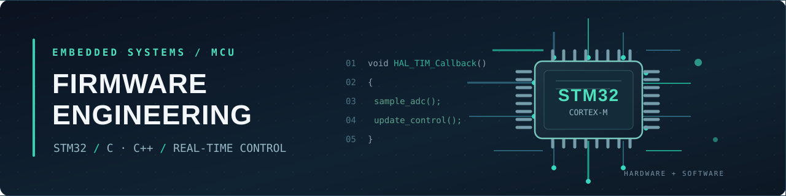

# 이선기 / Embedded Firmware Developer / mysunki

STM32 기반 의료기기 펌웨어를 개발하는 임베디드 소프트웨어 개발자입니다.  
제품 개발 초기 단계부터 양산 전환까지 참여하며 MCU 제어, 보드 간 통신, 신호 계측, 문제 분석 및 검증 업무를 수행했습니다.

- Portfolio: [mysunki.github.io](https://mysunki.github.io/)
- GitHub: [github.com/mysunki](https://github.com/mysunki)

---

## Featured Projects

| Project | Description |
| --- | --- |
| [Portfolio Website](https://github.com/mysunki/mysunki.github.io) / [Live Site](https://mysunki.github.io/) | 의료기기 펌웨어 경력, 기술 스택과 임베디드 프로젝트를 정리한 포트폴리오 |
| **Medical Device Firmware** / [Experience](https://mysunki.github.io/#experience) | STM32 기반 수술용 의료기기 제어, LCD-RF 보드 통신, DMA2D, Calibration 및 양산 이슈 대응 |
| **Voice Kiosk & Delivery Robot** / [Project](https://mysunki.github.io/#projects) | 음성 지원 키오스크와 MQTT 기반 물품 배송 로봇을 결합한 캡스톤 프로젝트 |
| [Firmware Career Tracker](https://github.com/mysunki/firmware-career-tracker) | 관심기업 채용공고 확인용 GitHub Pages 대시보드 |

---

## Technical Skills

- **MCU / Language:** STM32F4, STM32F072, Embedded C/C++, Python
- **Peripheral / Communication:** UART, SPI, I²C, ADC, DMA, Timer, Interrupt, MQTT
- **Development / Debugging:** IAR Embedded Workbench, SVN, Git, Oscilloscope
- **Display:** LCD, DMA2D, NOR Flash, SDRAM

> 업무 관련 비공개 소스코드, 회로도 및 내부 측정 데이터는 공개하지 않습니다.
